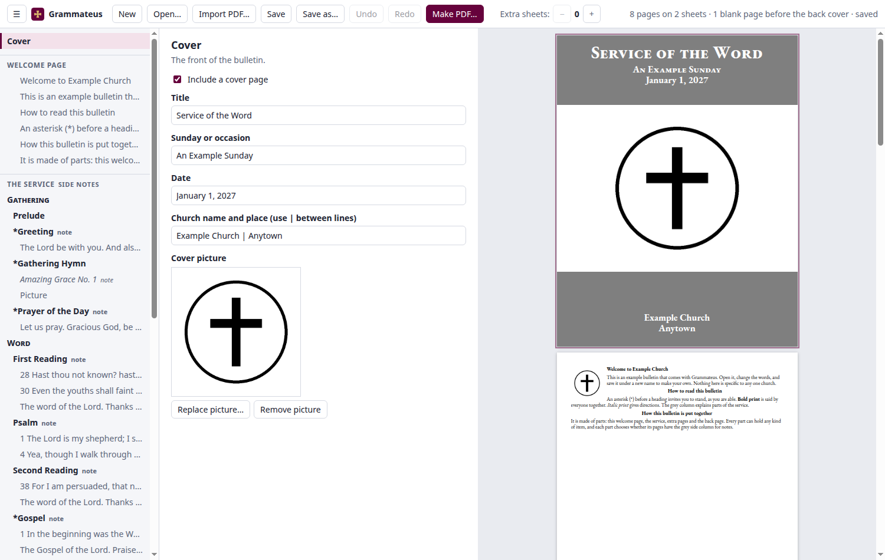

<h1 align="center">Grammateus</h1>

> ὁ δὲ εἶπεν αὐτοῖς· Διὰ τοῦτο πᾶς γραμματεὺς μαθητευθεὶς τῇ βασιλείᾳ τῶν οὐρανῶν ὅμοιός ἐστιν ἀνθρώπῳ οἰκοδεσπότῃ ὅστις ἐκβάλλει ἐκ τοῦ θησαυροῦ αὐτοῦ καινὰ καὶ παλαιά.
>
> Then said he unto them, Therefore every scribe which is instructed unto the kingdom of heaven is like unto a man that is an householder, which bringeth forth out of his treasure things new and old.
>
> — Matthew 13:52 (Greek: SBLGNT; English: KJV)

*Grammateus* (γραμματεύς) is the Greek word for a scribe.

A tool for producing weekly church bulletins.

You fill in the parts of the service, add the hymns and readings, and it lays out the pages and makes a PDF ready to send to the printer.

**[Download the latest version](https://github.com/aubrika/grammateus-releases/releases/latest)**

## Installing it

1. Open the download page above and choose the file ending in `.exe`.
2. Run the file. Windows will say it does not recognise the program. This is expected: choose **More info**, then **Run anyway**.
3. Open **Grammateus** from the Start menu.

It needs Windows 10 or later. It installs only for you and does not need an administrator.

## Trying it

- The program opens with an example bulletin. Click anything on the left, or on the pages on the right, to change it.
- **Make PDF…** writes the bulletin as a PDF.
- **Import PDF…** opens a bulletin PDF you already have, so you can carry on from it.
- **Save as…** keeps your bulletin as one file. Next week, open that file and save it under a new name.
- **Undo** takes back the last change.

## It is still being tested

This is an early version. If something goes wrong or is confusing, please tell the person who sent you here, or [describe it on the Issues page](https://github.com/aubrika/grammateus-releases/issues). It helps to say what you clicked and what happened.
